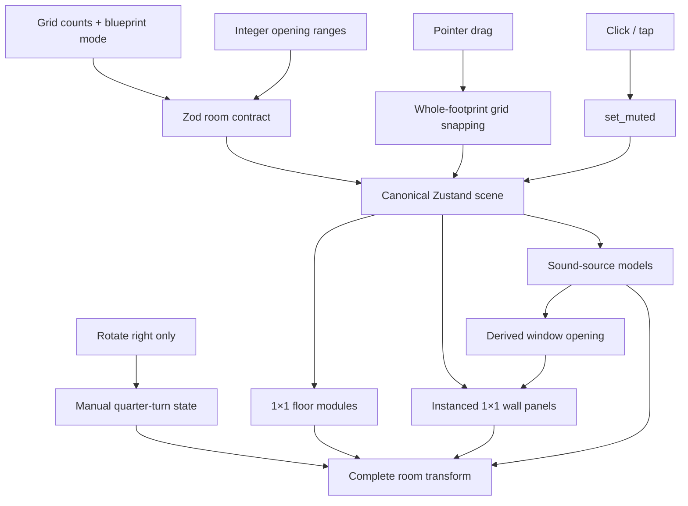

# Frontend architecture

[LAYOUT.md](../LAYOUT.md) is the authoritative room and interaction contract. [AGENTS.md](../AGENTS.md) directs future agents to it. The supplied [dimension profile](reference-dimensions.json) establishes grid-based Square/Rectangle room construction; the reference images guide the orthographic appearance, with shadows and decorative clutter excluded.

## Modular room state

The original app contains `RoomScene`, `RotationArrows` and one `PromptBar`. The latter owns its text in React state and uses the border-beam component; it does not mutate scene state or call a backend. The single canonical scene retains room/listener/objects/session data. `room.grid` stores integer columns, rows and wallHeight plus a Square/Rectangle mode. There is no competing room.size or adjustable metric segment size.

The default is 10 columns by 10 rows, wallHeight 7, calibrated to the supplied visual reference. Width/depth/height are derived in fixed block units. Square constrains only the two floor axes; height is independent. Rectangle supports unequal floor axes. Arbitrary floor masks and nonrectangular custom shapes are rejected.

Prototype bounds are 4–24 floor cells per axis and 2–12 height modules. These are implementation guardrails; the provided profile does not specify official game limits.

## Geometry and placement

Floor modules are centered at `[column + 0.5 - columns/2, 0, row + 0.5 - rows/2]`. Wall panels are one block wide/high, stacked independently to wallHeight. North/south lengths use columns; east/west lengths use rows. Each wall batches its body panels into one InstancedMesh.

`room.openings` stores rectangular column/level/span/height ranges for doors and windows. Validation checks wall bounds and unique IDs, and doors must start at floor level. Wall generation excludes occupied cells and leaves door cells completely open.

Sound-source windows derive their opening from their snapped position, wall and whole-segment footprint. Their geometry fills the occupied modules. Moving a window rebuilds the old/new wall cells without duplicating source placement in room state. Source windows reserve one full segment at each corner. Placement and scale fit the remaining wall span, so dragging to an end cannot remove the slab return and reveal a blank gap. The same rule applies to all four walls, rectangular rooms and resized windows.

Floor objects snap their entire footprint's starting cell, not just their center. This handles odd/even spans and asymmetric room counts correctly. Windows snap along their selected wall and to modular vertical levels. Other source heights use half-block steps. Full scaled geometry is kept inside the room. Wall-normal offsets account for wall/model depth.

## Continuous environment shell

`SLAB_THICKNESS` is fixed at 0.42 blocks and controls both wall depth and floor depth. It is independent of all room dimensions and environment presets. Full-size floor modules meet without gaps; wall corner panels use butt joints without overlap. The shell has no baseboard, cap, border, edge strip or stepped plinth.

`ROOM_THEMES` supplies one shared wall/floor surface color. Plain bedroom surfaces are clean neutral gray. Forest uses an earthy gray-green finish and a small dirt/moss palette. `buildSurfacePixels` generates sparse seeded marks, excluding complete door/window cutouts. `SurfacePixels` batches them into instanced flat squares on wall faces/tops and floor surfaces/edges. Wall marks use the same opacity and visibility lifecycle as the wall body. These surface details do not add canonical scene objects or shadow geometry.

## Interaction and view state

`useSceneStore` owns grid/openings, objects, mute flags and source positions. `useRoomStore` separately owns the camera, exact integer orientation, manual-animation lock and active gesture. Sources never receive world-rotated coordinates.

Mouse and touch share pointer capture and a 6px click/drag threshold. A click toggles muted without changing volume; a drag snaps to grid cells without muting. Escape, cancellation, lost capture, blur, unmount and source removal restore/cancel safely.

**There is no automatic rotation.** No edge dwell controller, timeout, automatic-turn action or post-turn drag rebasing remains. Holding any edge leaves orientation unchanged. The sole rotate button is disabled during gestures; after release it rotates the room by exactly 90° using a finite 720ms cubic ease.

## Camera and visibility

The orthographic camera uses 45° azimuth / 30° elevation. This produces the reference’s 1:2 floor-edge slope. The 10×10×7 default and uniform 0.42-block wall/floor slabs match its approximate 0.9355 outline height/width ratio. Calibration targets and estimated image landmarks live in [reference-proportions.json](reference-proportions.json). `roomCamera`, `ROOM_FRAME` and `roomProjectionEnvelope` centralize these calculations. Responsive framing reserves a 5.5% top inset and 160px bottom-controls clearance, fitting the complete rectangular diagonal envelope plus independent wall height throughout a turn. Reconfiguring grid counts reframes the room; dragging and rotation do not move the camera.

Near-wall transparency uses world-space normals/centers relative to that camera. Near-side source windows remain faint and interactive. Renderer shadows, casting/receiving flags, contact shadows, AO, baked shadows and CSS shadows are absent.

## Frontend-only scope

Every non-structural model is a sound source or its essential support. Sources use rain/fan/birds/speaker geometry, gray fading on mute and no text labels. Listener/session data remains in the contract without extra visible UI. No audio engine, backend or AI service is implemented. Future consumers can subscribe to the same scene store and apply validated operations.

## Verification

Logic tests cover modular validation, rectangular axes, independent height, openings, whole-footprint alignment, bounds, reference floor-edge slope and silhouette, muting, immutable transactions and manual rotation. Surface tests also cover fixed thickness across presets and sizes, clean plain rooms, stable forest details and opening exclusion. Browser suites exercise actual Square/Rectangle geometry, count modules, move windows between all walls, test openings, hold a dragged source at an edge past the former auto-turn delay, check manual rotation, touch input and cancellation, and inspect desktop/mobile framing without shadows or console errors.

## Interactive pixel-art rendering

`PixelRoomRenderer`, defined in the original `RoomScene.tsx`, renders both the wall/floor shell and live source meshes on the same low-resolution nearest-neighbor pixel grid. It quantizes both passes to the twenty colors used by the pxl artwork and composites them using separate wall/source depth textures. Multisampling and canvas antialiasing are disabled, so all inner/outer wall edges, slab faces and the room silhouette have consistent pixel steps. Original R3F geometry and pointer handlers remain active for every source. Temporary render visibility and material overrides are restored before event handling.

Prop motion uses a local, finite 16-frame loop at 10 fps: pane-clipped rain, three-fold fan rotation, small base wobble, offset bird bobs and blinks. Mute freezes the local timeline. Pixel rendering refreshes immediately for source edits and on every display frame during dragging/room rotation. Only the original root `index.html` → `main.tsx` → `App.tsx` → `RoomScene.tsx` frontend exists. Pixel compositing is implemented within that original scene file. Alternate HTML players and redirect pages have been removed; pxl exports remain image/data assets.
